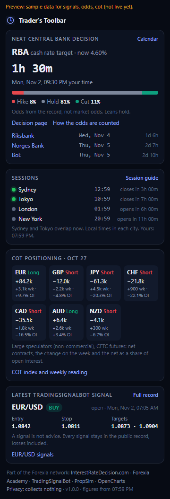

# Trader's Toolbar

A Chrome and Edge extension for forex traders. Click the toolbar icon for:

- **The next central bank decision**, with a live countdown, your local time, the rate going into it and its odds (hike, hold, cut). The odds are [InterestRateDecision.com](https://interestratedecision.com/rate-odds/?via=chrome-toolbar)'s own, counted from the record of past decisions, not market prices. The next three decisions are listed under it.
- **A session clock**: Sydney, Tokyo, London and New York, open or closed, and when each opens or closes. Daylight saving is handled by the browser's own time zone data, so the hours are right all year.
- **This week's COT positioning** for the seven majors against the dollar: large speculators net long or short in contracts, the change on the week and the net as a share of open interest, from CFTC data. Positions only; Forexia's COT index and weekly reading are on [forexiapro.com/cot-report](https://forexiapro.com/cot-report/?via=chrome-toolbar).
- **The latest TradingSignalBot signal**: pair, side, entry, stop and targets, with its chart.

The toolbar badge counts down to the next decision (`3d`, `14h`, `45m`) and turns amber in the last hour.



No account, no key, no tracking, no remote code. It reads four public JSON files and keeps the last copy in the browser.

## Install

From the Chrome Web Store or Edge Add-ons (links when published), or from this repository:

1. Download or clone it.
2. Open `chrome://extensions` (or `edge://extensions`), turn on **Developer mode**.
3. **Load unpacked** and pick this folder.

## Where the figures come from

| Panel | Feed | Licence |
| --- | --- | --- |
| Next decision | [`interestratedecision.com/data/next.json`](https://interestratedecision.com/data/next.json) | Free with a link |
| Odds | [`interestratedecision.com/data/odds.json`](https://interestratedecision.com/data/odds.json) | Free with a link |
| COT | [`ForexiaPro/cot-data`](https://github.com/ForexiaPro/cot-data) `data/latest.json` | CFTC data, public domain |
| Signal | [`tradingsignalbot.com/data/signals.json`](https://tradingsignalbot.com/data/signals.json) | TradingSignalBot's public record |

The feeds are fetched every 30 minutes by the service worker (`chrome.alarms`), and when the popup opens on figures older than 20 minutes. A feed that fails keeps its last good copy; the odds, COT and signal panels hide when their feed has nothing (or nothing newer than 8 days). The extension can reach only those three hosts (`host_permissions`), and asks for `alarms` and `storage` only.

The session hours are the usual ones: Sydney 07:00–16:00, Tokyo 09:00–18:00, London 08:00–17:00, New York 08:00–17:00, each in its own city's time, inside the forex week (Sunday 17:00 to Friday 17:00 New York).

A signal is not advice, and nothing here claims a result for anyone's signals: every TradingSignalBot signal stays in its [public record](https://tradingsignalbot.com/record/?via=chrome-toolbar), losses included.

## Develop

No build step: the files in `src/` are what ships.

```sh
npm test                 # node:test on src/lib.js (sessions with daylight saving, the feeds' shapes, the badge)
npm run icons            # redraw icons/*.png (no dependency)
npm run preview          # the popup in a tab at http://localhost:5175/dev/preview.html
node scripts/preview.mjs --shot docs/screenshot-popup.png path/to/shot.mjs   # a screenshot with Playwright
npm run pack             # dist/traders-toolbar-<version>.zip for the stores
```

The preview fetches the feeds live and uses `dev/samples/` for any feed that is not live yet, and says so above the popup. Do not use a screenshot with that line for a store listing.

| File | What it is |
| --- | --- |
| `manifest.json` | Manifest V3 |
| `src/lib.js` | Everything that is not the browser: parsing, countdowns, sessions, COT positions, links |
| `src/data.js` | Fetching, the cache in `chrome.storage.local`, the badge |
| `src/background.js` | The service worker: alarms every minute (badge) and 30 minutes (feeds) |
| `src/popup.*` | The popup |
| `docs/` | Store listing, privacy policy, Edge notes |

Every link carries `?via=chrome-toolbar`, so the sites can count visits from the extension. That is a word in the address of the page you open, nothing more: the extension itself sends nothing.

## Licence

MIT. See [LICENSE](LICENSE).

---

Part of the Forexia network: [InterestRateDecision.com](https://interestratedecision.com/?via=chrome-toolbar) · [Forexia Academy](https://forexiapro.com/?via=chrome-toolbar) · [TradingSignalBot](https://tradingsignalbot.com/?via=chrome-toolbar) · [PropSim](https://github.com/PropSim-Enterprise) · [OpenCharts](https://github.com/dylanpersonguy/OpenCharts)
